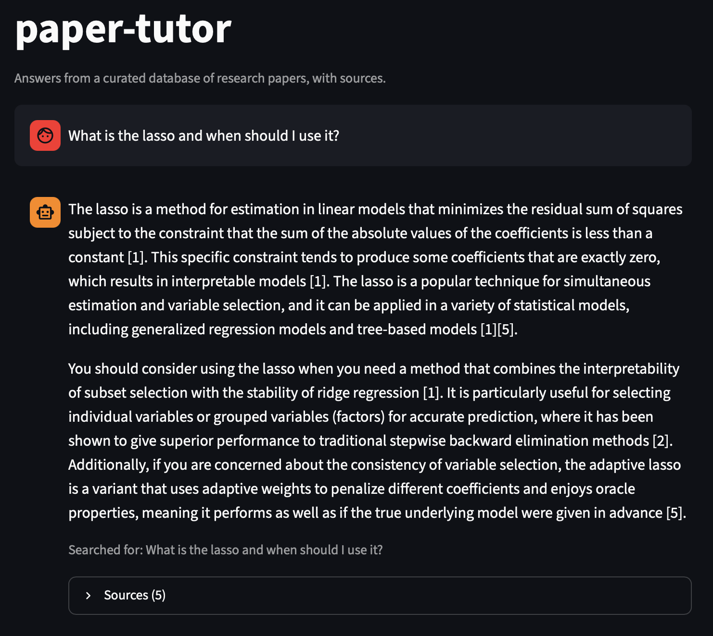
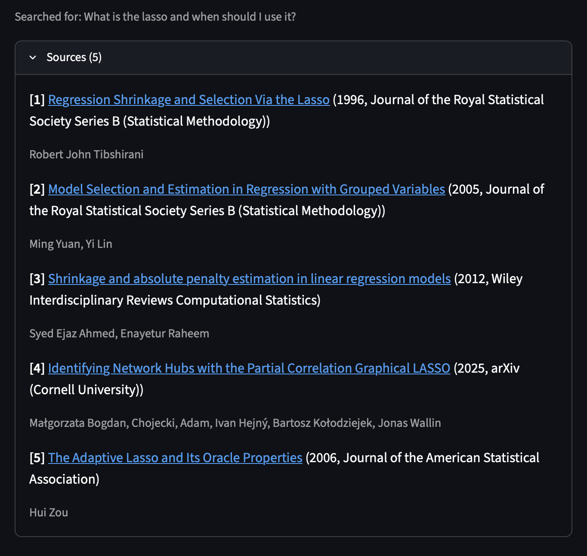
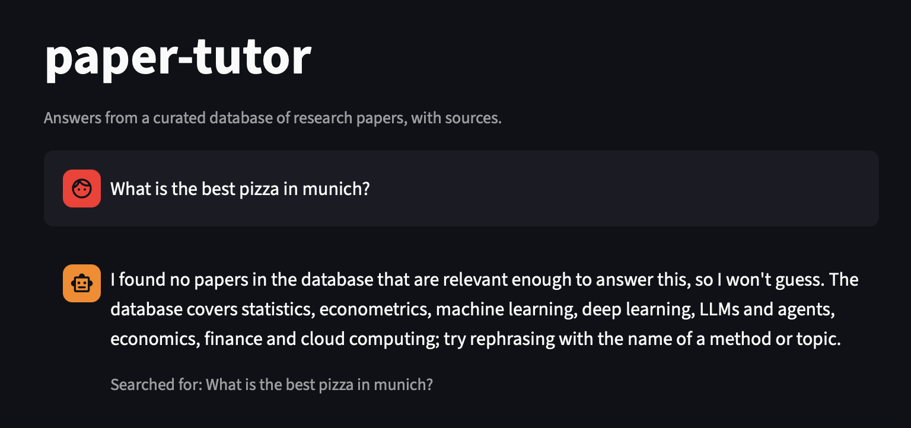
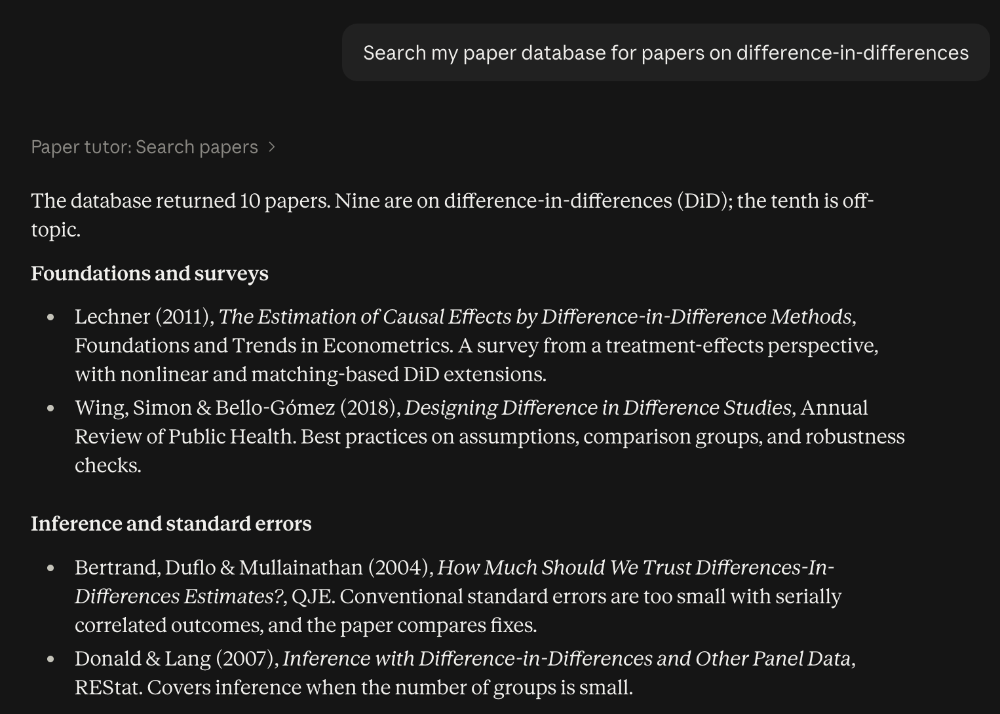
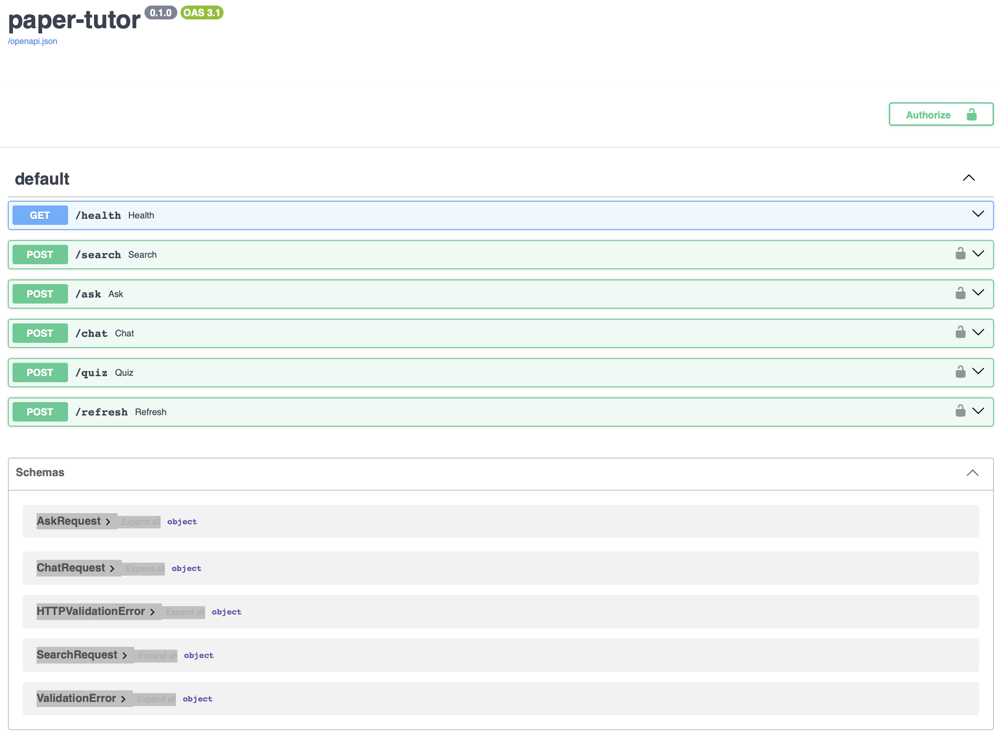
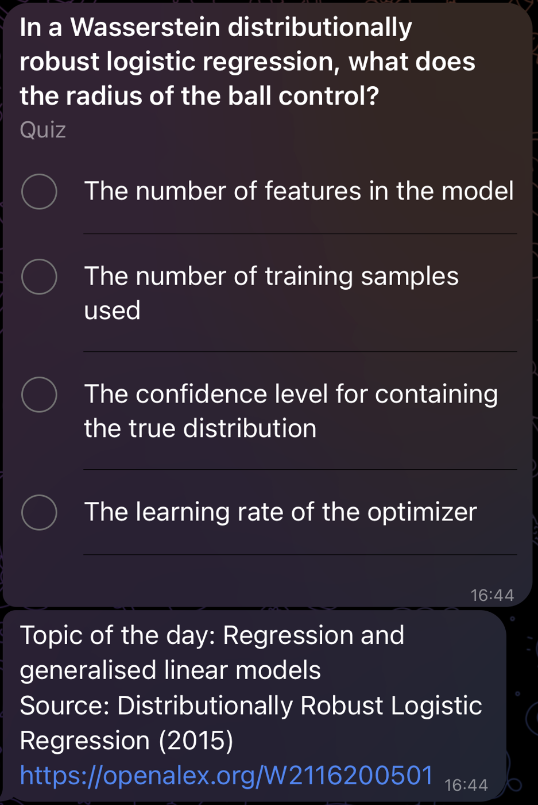
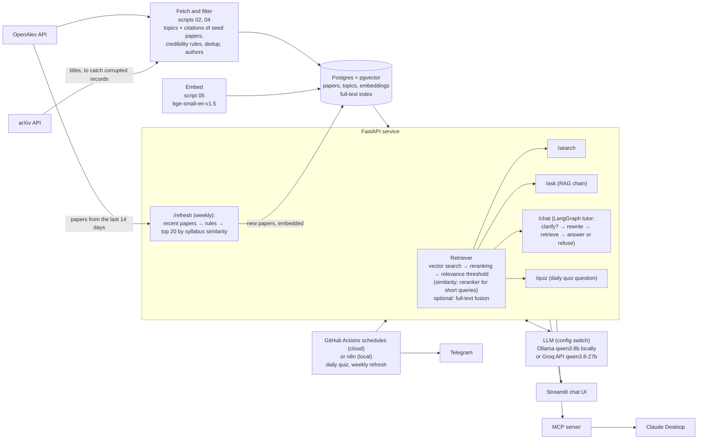

# paper-tutor


paper-tutor is a study assistant that answers questions from a curated database of
research papers instead of from the open web. It downloads papers from
[OpenAlex](https://openalex.org), keeps only those that pass a set of credibility rules
(peer-reviewed venue list, a real abstract, not retracted, English), removes duplicates,
stores them in Postgres with vector embeddings, and answers questions with an LLM
that must cite the papers it used, or say that the database has nothing relevant. It is
built the way a company would build an internal AI system over its own documents: a data
pipeline, a database, an HTTP API, a chat UI, a tool for an AI assistant, an evaluation of
retrieval quality, and a cloud deployment on Azure.
The current corpus has 7,186 papers in statistics, econometrics, machine learning, deep
learning, LLMs and agents, economics, finance and cloud infrastructure: 7,163 from the
initial download, 20 added by the first weekly refresh and 3 by the first cloud refresh.

**Stack:** Python · PostgreSQL + pgvector · FastAPI · LangChain · LangGraph · MCP · Ollama · Groq · Streamlit · n8n · Docker · GitHub Actions · Azure Container Apps · Azure Database for PostgreSQL

## Screenshots

| Answering with cited papers | The cited papers |
|---|---|
|  |  |

<details>
<summary><b>More screenshots</b>: refusal, MCP in Claude Desktop, API, Telegram quiz</summary>

<br>

**Refusing when the database has nothing relevant**



**Claude Desktop searching the database through MCP**



**API (FastAPI)**



**Daily quiz in Telegram**



</details>

## Documentation

This README is the overview. The details are in these files:

| File | What it contains |
|---|---|
| [docs/features.md](docs/features.md) | Every feature in detail: credibility rules, deduplication, the LLMs and agents area, weekly refresh, automations, retrieval, API endpoints, LLM provider, LangGraph tutor, MCP tool |
| [eval/README.md](eval/README.md) | Evaluation method, all result tables and caveats |
| [docs/data-checks.md](docs/data-checks.md) | Automated data-quality checks (reviews, title-abstract mismatches, area labels, corrupted arXiv records) and what to do about them |
| [sql/analytics/README.md](sql/analytics/README.md) | SQL analytics over the corpus: composition, impact (FWCI), missing data, trends, top authors and query performance |
| [docs/deployment.md](docs/deployment.md) | Azure cloud deployment, configuration and secrets, running the API in Docker, using it from Claude Desktop (MCP), and the n8n/Telegram automations |
| [docs/limitations.md](docs/limitations.md) | The full list of known limitations |

## Architecture



- **Pipeline** (`scripts/`): numbered scripts that fetch, explore, load, embed, search,
  evaluate and ask. Shared logic lives in `src/paper_tutor/`.
- **Database** (`sql/schema.sql`): three tables, `topics`, `papers` and `embeddings`
  (one row per paper and embedding model, so models can be compared side by side).
- **Analytics** (`sql/analytics/`): SQL queries for corpus statistics, data-quality checks,
  trends and query performance.
- **API** (`src/paper_tutor/api.py`): loads the retriever (embedding model and reranker),
  the LLM chain and the tutor once at startup.
- **Clients**: the Streamlit app, the MCP server and the scheduled jobs (GitHub Actions in
  the cloud, n8n locally) all talk to the API over HTTP.
- **Deployment**: locally with Docker Compose, in the cloud on Azure (see
  [docs/deployment.md](docs/deployment.md)).

## Features

Every behaviour can be switched in `config/syllabus.yaml`; the defaults are the best
settings measured. Full details: [docs/features.md](docs/features.md).

- **Credibility rules**: peer-reviewed venues (CWTS core list), trusted preprint servers
  only, no open-upload repositories such as Zenodo, real abstracts (30+ words), English, no retracted papers.
- **Deduplication**: preprint and published versions of the same paper are merged
  (75 duplicates).
- **LLMs and agents area**: built from the citation network of five seed papers (RAG,
  ReAct, Toolformer, Chain-of-Thought, GPT-3).
- **Retrieval**: vector search with pgvector, cross-encoder reranking and a relevance
  threshold, so the tutor refuses instead of answering from irrelevant papers.
- **LangGraph tutor**: asks a clarifying question for vague questions, rewrites
  follow-ups, and answers only from cited sources.
- **API** (FastAPI): `/search`, `/ask`, `/chat`, `/quiz`, `/refresh`, protected by an API
  key in the cloud.
- **MCP tool**: Claude Desktop can search the database and cite real papers.
- **Automations**: a daily quiz and a weekly refresh of new papers, sent to Telegram.

## Evaluation

34 test questions, 444 pooled relevance judgments (75 by hand), plus 50 out-of-scope and
keyword queries. Full method, all tables and caveats: [eval/README.md](eval/README.md).

| What is measured | Result |
|---|---|
| Retrieval: relevant paper in the top 5 (pooled judgments) | 30/34 with the reranker (25/34 without) |
| Retrieval: MRR (pooled judgments) | 0.76 with the reranker (0.64 without) |
| In-scope queries answered, off-topic queries refused | 84/84 (30/30 on held-out queries) |
| Citations supported by the cited abstract (8B judge) | 31/34 with the reranker (22/30 without; 24/30 before), strict prompt; a hand check finds the judge too lenient |

### LangSmith experiments and tracing

The same evaluation also runs as [LangSmith](https://smith.langchain.com) experiments, so runs
can be compared side by side and every question's retrieval can be inspected as a trace
(`LANGSMITH_*` variables in `.env`, see [docs/deployment.md](docs/deployment.md)):

```bash
uv run python scripts/17_langsmith_eval.py retrieval   # dataset paper-tutor-retrieval, rerank on and off
uv run python scripts/17_langsmith_eval.py answers     # full tutor on 10 questions, groundedness judge
```

The dataset is synced from `eval/questions.yaml` and the pooled judgments on every run
(idempotent). The retrieval experiments run only the retriever and score its top 5:

| Experiment | hit@5 (pooled) | MRR@5 |
|---|---|---|
| `rerank-on` (default) | 30/34 | 0.76 |
| `rerank-off` | 25/34 | 0.62 |

The hits match `scripts/08_pooled_evaluate.py`; its MRR (0.76 and 0.64) counts the top 10.
Per-question results of both runs: [public LangSmith comparison](https://smith.langchain.com/public/aa3364a7-4317-4d2f-8e36-da216e628ed5/d/compare?selectedSessions=c11bfd89-8bcb-4010-8605-708c0a4fc8f5,d8bf79e5-dfd8-4063-aef8-54e26d2595fd).
The answer experiment asks the Groq model whether every claim in an answer is supported by
the cited papers: 10/10 answers grounded. The judge is the model that wrote the answers and
judges whole answers, so it is more lenient than the per-citation check above.

With tracing on, every request is one trace with separate runs for vector search, reranking
and the LLM call (tokens, and cost at Groq's list price), tagged with the model, git commit
and retrieval settings.

## Corpus analytics (SQL)

Highlights from the SQL queries in `sql/analytics/`. All findings:
[sql/analytics/README.md](sql/analytics/README.md).

- **FWCI is right-skewed in every area** (deep learning: mean 69.2, median 24.5), and it is
  unreliable for recent papers: without a year limit, little-known 2024–2025 papers rank
  above landmark papers like ImageNet and ResNet.
- **Missing data**: 48.8% of papers have no open-access link, 17 have no authors and 4 have
  no year.
- **Embeddings**: 3 papers have no `qwen3-0.6b` embedding, all loaded by the first cloud
  refresh, which only embeds with the active model.
- **Performance**: the GIN index on the stored `search_text` column makes full-text search
  more than 5,000× faster (493 ms → 0.09 ms).

## Quickstart

You need [uv](https://docs.astral.sh/uv/), [Docker](https://www.docker.com/) with Docker
Compose, an [OpenAlex API key](https://openalex.org), and an LLM: a free
[Groq](https://console.groq.com) API key or [Ollama](https://ollama.com) with
`qwen3:8b`. Put the keys in a `.env` file in the project root (`OPENALEX_API_KEY`,
`POSTGRES_PASSWORD`, `GROQ_API_KEY`).

```bash
uv sync               # install dependencies
make rebuild          # start Postgres, create tables, fetch, load and embed papers
make api              # start the API on http://127.0.0.1:8000 (keep it running)
make ui               # in a second terminal: start the chat UI
```

All `make` targets, running the API in Docker, MCP setup and the automations:
[docs/deployment.md](docs/deployment.md).

## Known limitations

The most important ones; the full list is in [docs/limitations.md](docs/limitations.md).

- **Most relevance judgments come from an LLM.** 75 of 444 are human; a hand-checked
  sample agreed 19/20 with the LLM labels, but the set is still small (34 questions).
- **Citations from the 8B model are not always faithful**, even with the strict prompt,
  and the faithfulness check uses the same 8B model as judge
  ([#7](https://github.com/AymenFeki/paper-tutor/issues/7)).
- **Area labels are noisy**: 20% of papers are closer to another area, mostly at natural
  borders ([#21](https://github.com/AymenFeki/paper-tutor/issues/21)).
- **The weekly refresh never covers the LLMs and agents area**, because it only queries
  OpenAlex topics.
- **Cold start**: after a period without traffic, the first request to the cloud API takes
  about a minute. That is the cost of scaling to zero.

## Roadmap

- Add new LLM and agent papers in the weekly refresh ([#25](https://github.com/AymenFeki/paper-tutor/issues/25)).
- A quota per area in the refresh instead of one global top 20 ([#26](https://github.com/AymenFeki/paper-tutor/issues/26)).
- Fix papers assigned to the wrong area ([#21](https://github.com/AymenFeki/paper-tutor/issues/21)).
- More data sources and better coverage for all areas ([#8](https://github.com/AymenFeki/paper-tutor/issues/8)).