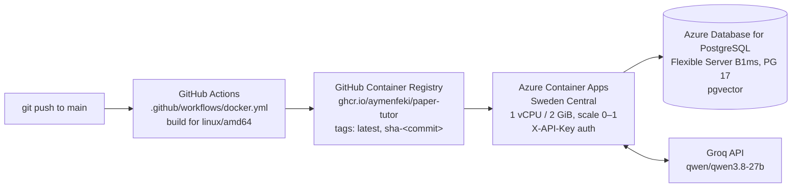
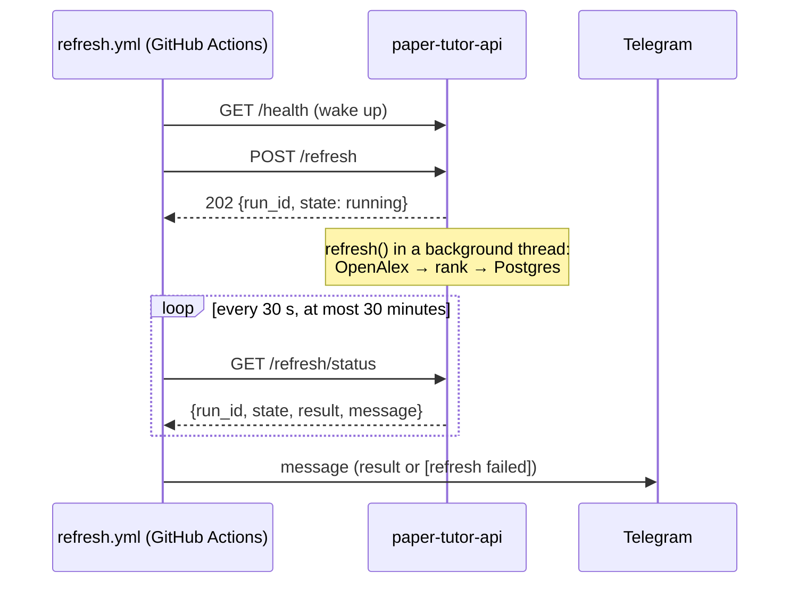

# Running and deploying

[← Back to the README](../README.md)

## Local setup

### Prerequisites

- [uv](https://docs.astral.sh/uv/) (Python 3.12 is installed by uv if needed)
- [Docker](https://www.docker.com/) with Docker Compose
- An LLM, chosen with `llm.provider` in the config: a free [Groq](https://console.groq.com)
  API key (`groq`), or [Ollama](https://ollama.com) with the model pulled:
  `ollama pull qwen3:8b` (`ollama`)
- An [OpenAlex API key](https://openalex.org)
- A `.env` file in the project root with these variables (`NAME=value`, no spaces around
  `=`, so Docker can read it too):
  - `OPENALEX_API_KEY`: your OpenAlex key
  - `POSTGRES_PASSWORD`: any password; Docker Compose uses it to create the database
  - `GROQ_API_KEY`: needed when `llm.provider` is `groq`
  - optional, for the n8n automations: `TELEGRAM_BOT_TOKEN` (from @BotFather) and
    `TELEGRAM_CHAT_ID`
  - optional, for tracing in [LangSmith](https://smith.langchain.com): `LANGSMITH_API_KEY`,
    `LANGSMITH_TRACING=true` and `LANGSMITH_PROJECT` (e.g. `paper-tutor`); without them nothing is traced

### Build the database and start the app

```bash
uv sync               # install dependencies
make rebuild          # start Postgres, create tables, fetch, load and embed papers
make api              # start the API on http://127.0.0.1:8000 (keep it running)
make ui               # in a second terminal: start the chat UI
```

Other targets: `make test` (unit tests), `make lint` (ruff), the single steps
`make db-up`, `make schema`, `make fetch`, `make load`, `make embed`, `make refresh`, the evaluations
`make evaluate`, `make threshold`, `make keyword-queries` and `make faithfulness`, and
`make data-checks` and `make judge`. Fetching skips topics, seed areas, authors and arXiv
titles that are already downloaded to `data/raw/`. Loading removes papers from the
database that no longer pass the rules or are not in `data/raw/` (including the refreshed
papers in `data/raw/recent/`), together with their embeddings.

Try the API directly:

```bash
curl -X POST http://127.0.0.1:8000/search \
  -H "Content-Type: application/json" \
  -d '{"question": "What is the lasso?", "k": 3}'
```

### Run the API in Docker

The same image that runs on Azure, against the local database (port 8001, so it does not
clash with `make api`):

```bash
docker build -t paper-tutor-api .
docker run --rm -p 8001:8000 --env-file .env -e POSTGRES_HOST=host.docker.internal paper-tutor-api
```

### Use it from Claude Desktop (MCP)

With the API running, add this to Claude Desktop's `claude_desktop_config.json` and
restart Claude Desktop. Replace the paths with your own (`which uv` shows the path to uv).

```json
{
  "mcpServers": {
    "paper-tutor": {
      "command": "/absolute/path/to/uv",
      "args": [
        "--directory", "/absolute/path/to/paper-tutor",
        "run", "python", "-m", "paper_tutor.mcp_server"
      ]
    }
  }
}
```

The MCP server calls the API at `http://127.0.0.1:8000`; set `PAPER_TUTOR_API` in an
`"env"` block to change it.

### Automations with n8n and Telegram (local)

The cloud runs the same jobs with GitHub Actions (see [Cloud deployment](#cloud-deployment)).
To run them locally instead:

1. `docker compose up -d` also starts n8n on http://localhost:5678. It reads
  `TELEGRAM_BOT_TOKEN` from `.env`, so the token never appears in a workflow.
2. In n8n, import `n8n/daily_quiz.json` and `n8n/weekly_refresh.json`, add a Telegram
  credential, set your chat id, and publish both workflows.
3. Keep the API running (`make api`); n8n reaches it at `http://host.docker.internal:8000`.

## Cloud deployment

The API runs on Azure ([#18](https://github.com/AymenFeki/paper-tutor/issues/18)). Every
push to `main` that changes the code builds a new image automatically:



| Part | Service | Notes |
|---|---|---|
| API container | Azure Container Apps | 1 vCPU / 2 GiB, scales to zero when idle, at most 1 replica |
| Database | Azure Database for PostgreSQL Flexible Server (B1ms, PostgreSQL 17) | pgvector enabled; filled from the local database with `pg_dump`/`pg_restore` (7,183 papers) |
| LLM | Groq (`qwen/qwen3.8-27b`) | `provider: groq` in `config/syllabus.yaml` |
| Image registry | GitHub Container Registry | built by `.github/workflows/docker.yml`, tagged `latest` and `sha-<commit>` |

- **Image** (`Dockerfile`): Python 3.12 slim with uv. A CPU-only PyTorch build
  (`[tool.uv.sources]` in `pyproject.toml`, Linux only) keeps the image at about 1.6 GB
  compressed instead of 20+ GB with the CUDA libraries. The embedding model and the
  reranker are downloaded at build time, so a cold start does not download them, and
  `HF_HUB_OFFLINE=1` keeps the container from contacting Hugging Face. Dependencies are
  installed before the code is copied, so a code change rebuilds in seconds.
- **Secrets**: the Groq key, the database password and the API key are Container Apps
  secrets, passed to the container as environment variables. They are never in the image
  or the repository (`.env` is excluded by `.dockerignore` and `.gitignore`).
- **Configuration** (environment variables; the defaults are the local Docker database):

  | Variable | Default (local) | Cloud |
  |---|---|---|
  | `POSTGRES_HOST` | `localhost` | Azure server hostname |
  | `POSTGRES_PORT`, `POSTGRES_DB`, `POSTGRES_USER` | `5432`, `paper_tutor`, `tutor` | same |
  | `POSTGRES_PASSWORD` | from `.env` | secret |
  | `POSTGRES_SSLMODE` | `prefer` | `require` |
  | `GROQ_API_KEY` | from `.env` | secret |
  | `API_KEY` | not set (no auth) | secret |
  | `LANGSMITH_API_KEY` | from `.env` | secret |
  | `LANGSMITH_TRACING` | `true` in `.env` | `true` |
  | `LANGSMITH_PROJECT` | `paper-tutor` | `paper-tutor-prod` |

- **Cost**: inside the Azure for Students free tier. B1ms with 32 GB storage is free for
  12 months (750 hours a month), and scale-to-zero keeps the container within the monthly
  free grant of Container Apps.
- **Scheduled jobs**: GitHub Actions calls the cloud API on a schedule (cron in UTC): the
  daily quiz at 08:00 UTC and the weekly refresh on Sundays at 18:00 UTC. They need four
  repository secrets: `CLOUD_API_URL`, `CLOUD_API_KEY`, `TELEGRAM_BOT_TOKEN` and
  `TELEGRAM_CHAT_ID`. The cloud refresh needs `OPENALEX_API_KEY` as a Container Apps secret.
  Both can also be started by hand from the Actions tab (*Run workflow*). The weekly refresh
  runs in the background of the API, because it no longer fits in one HTTP request
  ([#37](https://github.com/AymenFeki/paper-tutor/issues/37)); see
  [Weekly refresh](#weekly-refresh).
- **Keeping the local copy in sync**: the cloud database is the one that grows. To bring
  refreshed papers to the local database:

  ```bash
  POSTGRES_HOST=<azure host> POSTGRES_PASSWORD=<azure password> POSTGRES_SSLMODE=require make pull-refreshed
  make load && make embed
  ```

### Weekly refresh

Container Apps ends HTTP requests after about 4 minutes, and `POST /refresh` already took
220–252 s in production before the agent refresh topics (#25) added about 20% more candidates
([#37](https://github.com/AymenFeki/paper-tutor/issues/37)). The refresh therefore runs in a
background thread of the API, and the workflow asks for the result every 30 seconds:



- **`POST /refresh`** (`?dry_run=true` to write nothing) answers at once with `202` and the run
  (`run_id`, `state: running`), or with `409` and the current run if a refresh is already
  running. Only one refresh runs at a time.
- **`GET /refresh/status`** returns the last run: `state` is `running`, `done` (with `result`)
  or `failed` (with `error`), plus `duration_s` and `message`, the Telegram text (the same
  format as before; secret values in errors are replaced by `***`). `404` if there was no
  refresh since the server started. The result also has `fetched` (papers from OpenAlex,
  before the rules) and `timings_s`, the seconds per phase (`fetch`, `rank`, `save`); the
  workflow prints the final status and one line per poll.
- **Duration**: the first production dry run (30 Oct 2026) took 718 s for 3,464 candidates,
  about 0.2 s per candidate on 1 vCPU. The duration grows with the number of candidates
  (OpenAlex returned about 1,200 a week earlier); the workflow allows 30 minutes.
- **The polling keeps the API awake**: it scales to zero after 300 s without requests, and the
  background thread does not count as traffic.
- **Limits**: the status lives in memory, so this needs a single replica (`maxReplicas` is 1;
  with more, a poll could reach a replica that knows nothing about the run). A restart during
  the refresh loses the status; the workflow then sees `404` or another `run_id` and sends
  `[refresh failed] status lost`. Papers written before the restart stay, and a new run adds
  the rest.
- **By hand**: Actions tab → *Weekly refresh* → *Run workflow*, with *dry run* to write nothing.
- **Why not a Container Apps job**: a job would run the refresh outside any HTTP request
  (`paper-tutor-refresh`, PR [#38](https://github.com/AymenFeki/paper-tutor/pull/38)), but the
  Azure for Students subscription rejects jobs (`ExpressEnvironmentResourceNotSupported`),
  also in a new workload-profiles environment. The command still runs locally, against the
  local database (`TELEGRAM_BOT_TOKEN=` keeps it from sending to Telegram):

  ```bash
  TELEGRAM_BOT_TOKEN= uv run paper-tutor-refresh --dry-run
  ```

### Release checklist

The API does not pick up a new image by itself. After a push to `main` has built the image
(*Docker image* workflow in the Actions tab), deploy that commit:

```bash
TAG=sha-$(git rev-parse origin/main | cut -c1-7)
IMAGE=ghcr.io/aymenfeki/paper-tutor:$TAG
docker manifest inspect "$IMAGE" > /dev/null && echo "$IMAGE exists"
```

```bash
az containerapp update -n paper-tutor-api -g paper-tutor-rg --image "$IMAGE"
```

```bash
az containerapp show -n paper-tutor-api -g paper-tutor-rg --query "properties.template.containers[0].image" -o tsv
```

### Monitoring in LangSmith

Production traces go to the LangSmith project `paper-tutor-prod`, local ones to `paper-tutor`.
A tutor trace (`/chat`) has the question in `input.messages`, the answer as the last item of
`output.messages` and the retrieved papers (title, abstract, scores) in `output.papers`; the
numbers the answer cites, [1] to [5], are positions in that list.

An online LLM-as-judge evaluator checks about 20% of the tutor traces for groundedness. It is
set up in the LangSmith UI (the SDK cannot yet create sampling rules): on the project
`paper-tutor-prod`, add an LLM-as-judge evaluator with a filter on root runs named `tutor`
(`LangGraph` for images built before tracing was added), sampling rate 0.2, the Groq model
`qwen/qwen3.8-27b` (needs `GROQ_API_KEY` as a LangSmith workspace secret), this prompt and a
boolean feedback key `is_grounded`:

```text
You check whether a study tutor's answer is grounded in its sources.

Question: {{question}}

Sources (a JSON list of papers; the answer's citation [n] is the n-th paper):
{{context}}

Conversation (the last message is the answer to check):
{{answer}}

Is every claim in the answer supported by the sources it cites?
- A claim is supported only if a cited paper's title or abstract states it or it follows directly from it.
- A claim that is true but comes from outside knowledge, not from the cited papers, is NOT supported.
- A claim without a citation is NOT supported, unless it only restates the question or says that
  the sources do not cover something.
- Citing a source number that does not exist is NOT supported.
- If the answer only says that no relevant papers were found, it is grounded.
```

Variable mapping: `question` → `input.messages`, `context` → `output.papers`,
`answer` → `output.messages`. The offline version of this judge is
`scripts/17_langsmith_eval.py answers`.

Health check of the live API (the other endpoints need the key):

```bash
curl https://paper-tutor-api.blackpebble-a7183b5c.swedencentral.azurecontainerapps.io/health
```

A question to the live API:

```bash
curl -X POST https://paper-tutor-api.blackpebble-a7183b5c.swedencentral.azurecontainerapps.io/ask \
  -H "Content-Type: application/json" \
  -H "X-API-Key: $CLOUD_API_KEY" \
  -d '{"question": "What is the lasso?"}'
```